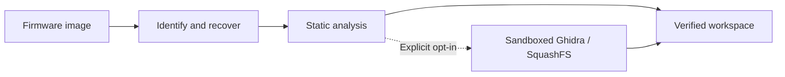

<div align="center">

# NYRA FWLab

**From firmware bytes to evidence you can inspect, verify, and build on.**

[](https://github.com/WhyzperMe/nyra-fwlab/actions/workflows/ci.yml)
[](rust-toolchain.toml)
[](LICENSE)

Offline firmware recovery and static reverse engineering in Rust.<br>
Bounded parsers · Source provenance · Sandboxed Ghidra · Verified Claude workspaces

[Quick start](#quick-start) · [Supported formats](#supported-formats) · [Workspace](#your-workspace) · [Documentation](docs/README.md)

</div>

---

NYRA FWLab helps you recover supported firmware packages, understand their contents,
and create a traceable workspace for manual analysis or Claude Code. Original bytes,
recovered members, inferred findings, and editable reconstruction stay separate.

> [!IMPORTANT]
> NYRA FWLab never executes recovered firmware or flashes a device. Checksums and
> replay establish byte consistency; they do not prove vendor authenticity,
> complete flash coverage, hardware behavior, or bootability.

## Why use it?

| Task | What NYRA gives you |
| --- | --- |
| Recover an update package | Bounded extraction, per-member checks where available, exact source ranges, and explicit exclusions. |
| Investigate an unfamiliar image | Embedded-format candidates with validation checks, overlaps, evidence tiers, and concrete next steps. |
| Understand the binaries | ELF metadata, dependencies, symbols, boot/configuration candidates, and hardware observations with provenance. |
| Hand evidence to Claude Code | A verified artifact catalog, firmware map, hardware overview, open questions, and a prioritized task plan. |
| Check someone else's result | Independent workspace hashing and source replay; optional comparison with an external golden manifest. |



Unknown or damaged input is rejected by default. With `--allow-partial`, NYRA preserves
it and records bounded findings and eligible raw carves. A signature match alone is
never promoted to verified recovery.

## Quick start

**Requirements:** Rust **1.95.0** and Python 3.10+ for the checked release-build helper.
The core CLI is tested on Windows and Linux. Optional external tools run on Linux,
including WSL2 hosts that permit unprivileged user namespaces.

```bash
git clone https://github.com/WhyzperMe/nyra-fwlab.git
cd nyra-fwlab
python -B scripts/build-release.py
```

The helper builds the locked workspace, remaps local build paths, and checks the
release executable. The examples use `./target/release/nyra-fw`; on Windows the
executable is `nyra-fw.exe`.

```bash
# 1. Identify the image without extracting it.
./target/release/nyra-fw scan firmware.pkg --json

# 2. Create a fresh evidence workspace.
./target/release/nyra-fw analyze firmware.pkg -o "$HOME/nyra-workspaces/sample"

# 3. Re-derive artifacts and verify the agent handoff.
./target/release/nyra-fw verify "$HOME/nyra-workspaces/sample" --replay --agent-ready
```

Choose an output parent you control and a fresh destination. Under WSL, use a native
Linux output directory such as `$HOME/nyra-workspaces`; Windows mounts can reject the
atomic directory publication required by NYRA.

### Common workflows

```bash
# Diagnose unfamiliar input and preserve partial evidence.
./target/release/nyra-fw scan unknown.bin --candidates --json
./target/release/nyra-fw analyze unknown.bin -o "$HOME/nyra-workspaces/unknown" --allow-partial

# Inspect verified reports or reuse a matching completed offline run.
./target/release/nyra-fw inspect "$HOME/nyra-workspaces/sample" --json
./target/release/nyra-fw analyze firmware.pkg -o "$HOME/nyra-workspaces/sample" --resume

# Create and verify a separate evidence-only agent handoff.
./target/release/nyra-fw export-agent "$HOME/nyra-workspaces/sample" -o "$HOME/nyra-workspaces/agent-export"
./target/release/nyra-fw verify-agent-export "$HOME/nyra-workspaces/agent-export"
```

`--threads` bounds CPU workers: automatic selection uses up to eight; the explicit
maximum is sixteen. `--run-timeout-seconds` bounds the invocation. Add
`--timings --json` to analysis to keep deterministic JSON on stdout and phase timings
on stderr. [CLI and recovery details](docs/formats.md)

## Supported formats

Support describes the checked subset, not a claim that every image with that
extension can be reconstructed.

| Input | Validation and recovery |
| --- | --- |
| **HiChip PIHC** | Header bounds, raw carves, and individually CRC-verified ZIP members; separate ZIP directory audit. |
| **Classic ZIP** | Matching central/local records, streamed data descriptors, portable paths, stored/DEFLATE decoding, and member CRCs. |
| **USTAR / GNU TAR subset** | Checksummed headers and bounded regular-file ranges; raw members retain SHA-256 provenance and an unverified classification. |
| **SquashFS 4.0** | Superblock and metadata-table bounds; opt-in extraction inventories regular files and records links as metadata. |
| **ELF** | Bounded header, dependency, symbol, and addressed-string inspection. |
| **Single-member gzip** | Bounded decompression, CRC and ISIZE validation; eligible payloads enter static analysis. |
| **Legacy U-Boot uImage** | Header/payload CRCs, bounded payload carving, load/entry addresses, and numeric type metadata. |
| **Unknown / damaged images** | Conservative candidate discovery; optional partial preservation with explicit failed checks and unresolved overlaps. |

[Exact format boundaries](docs/formats.md) · [Embedded candidate discovery](docs/candidates.md)

## Your workspace

```text
workspace/
├── original/          Exact input bytes
├── recovered/         Recovered members and classified raw carves
├── analysis/          Static findings, component graph, and evidence index
├── manifests/         Source identities, hashes, and run metadata
└── reconstruction/    Editable notes and reconstruction work
```

Each workspace also includes generated firmware/hardware maps and agent guidance.
Before loading that guidance into Claude Code or another agent, run
`verify --agent-ready` with a trusted NYRA binary. Then follow the verified guidance
and `analysis/workspace/agent-index.json`.

Keep firmware strings, logs, scripts, and pseudocode in the evidence layer. Edit
`reconstruction/`; changes to the immutable evidence tree are detected by verification.
[Agent workflow](docs/agent-workflow.md) · [Workspace contracts](docs/workspace-schema.md)

## Optional Ghidra and filesystem analysis

On Linux/WSL, provision trusted **bubblewrap, util-linux, GNU tar, awk, and
squashfs-tools**. Ghidra additionally needs a trusted installation and compatible
Linux JDK. Tools run with explicit opt-in, bounded resources, and network isolation.

```bash
./target/release/nyra-fw analyze firmware.pkg \
  -o "$HOME/nyra-workspaces/rootfs" --extract-filesystems

NYRA_JAVA_HOME=/opt/jdk-25 ./target/release/nyra-fw analyze firmware.pkg \
  -o "$HOME/nyra-workspaces/ghidra" \
  --ghidra-headless /opt/ghidra/support/analyzeHeadless
```

Tool failures abort publication by default. `--allow-partial-tools` records an optional
tool failure while retaining other verified results; `--allow-partial` separately
controls firmware recovery. Validated Ghidra export caching is opt-in with
`--ghidra-cache`; it requires an explicit `NYRA_JAVA_HOME` and a private cache directory.
Use `--require-cgroup` to require delegated process-tree resource limits.

Ghidra pseudocode is inferred, and static references can miss indirect calls.
[Sandbox and trust model](docs/security.md) · [Live Ghidra qualification](docs/corpus.md#security-gates)

## Evidence and validation

| Check | Recorded result |
| --- | --- |
| **SSC338Q golden recovery** | All **493 filenames and SHA-256 values** match the independent reference; replay re-derives **495 artifacts**. |
| **Determinism** | One- and eight-worker SSC338Q workspaces are byte-identical. |
| **Native release builds** | Byte-identical repeated builds per tested Windows/Linux host, with local build-path checks. |
| **Live Ghidra** | Ghidra **12.2** with Linux JDK **25.0.5** passed reference-ELF and SSC338Q ARM analysis, export/cache checks, and replay. |
| **Hostile-input coverage** | Independent format fixtures, regression tests, bounded parser fuzzing, and sandbox failure gates. |

These results cover the documented inputs and toolchains. Performance measurements
are mixed; no general speedup or universal firmware support is claimed. The CI badge
links to current hosted results. [Full validation record and limitations](VALIDATION.md)

## Documentation

- [Architecture and development checks](docs/architecture.md)
- [Security model and safety contracts](docs/security.md)
- [Supported formats and candidate discovery](docs/formats.md)
- [Workspace schema and agent workflow](docs/workspace-schema.md)
- [Independent corpus and performance measurements](docs/corpus.md)
- [Security reporting](SECURITY.md) · [Changelog](CHANGELOG.md)

## License

**MIT · [Whyzper.Me](https://github.com/WhyzperMe)** — see [LICENSE](LICENSE).
The repository license grants no rights to external firmware. Dependencies retain
their own licenses; the PIHC format constants are disclosed in [SECURITY.md](SECURITY.md).
